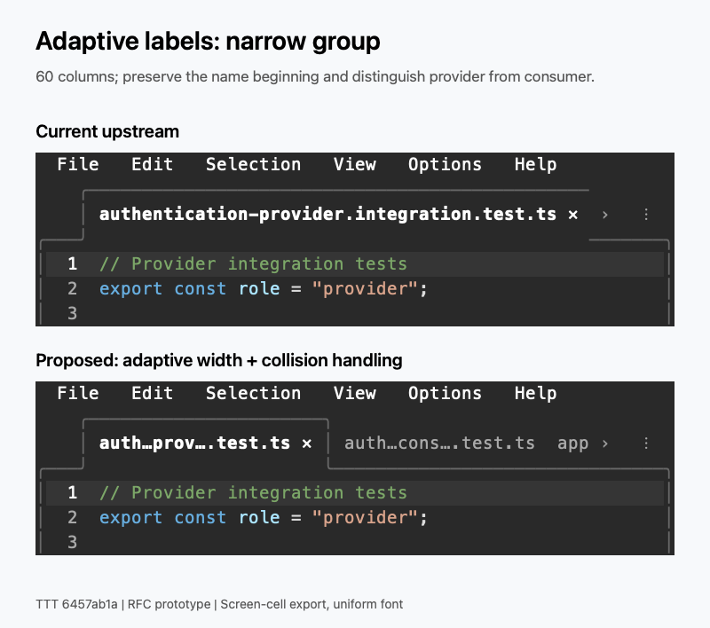
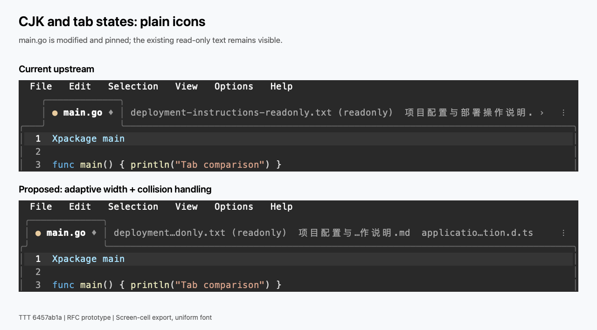
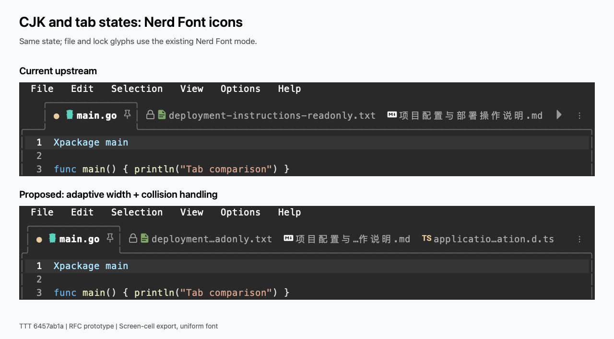
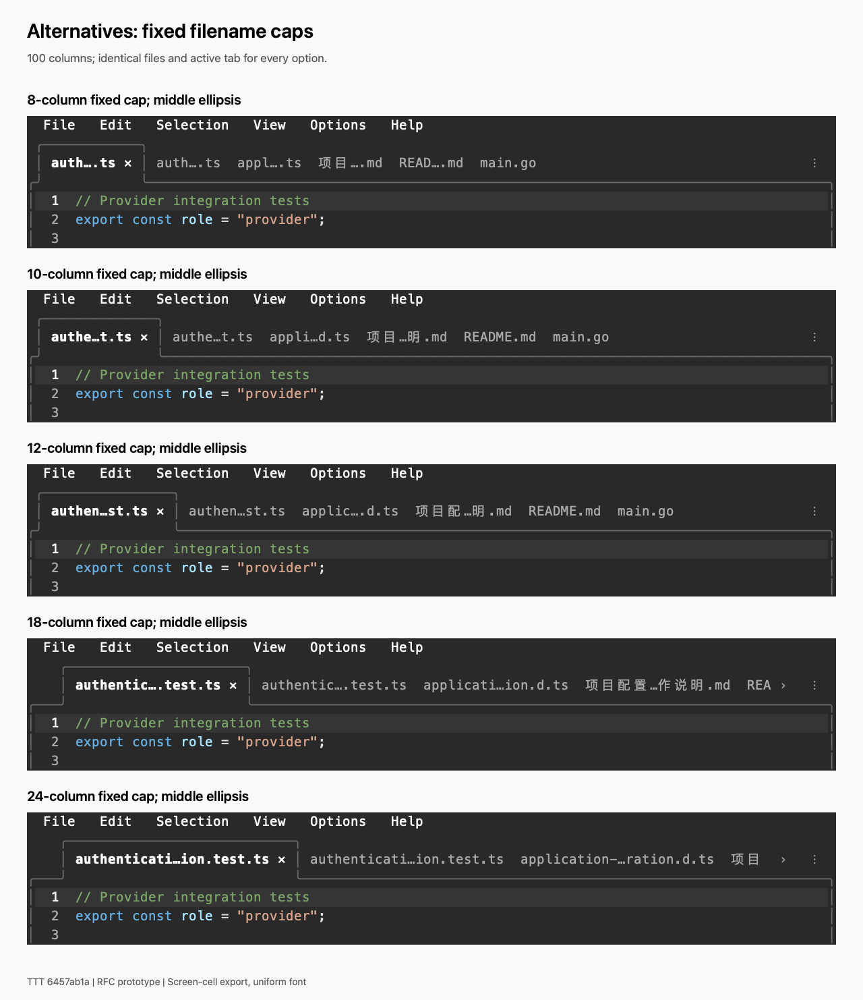
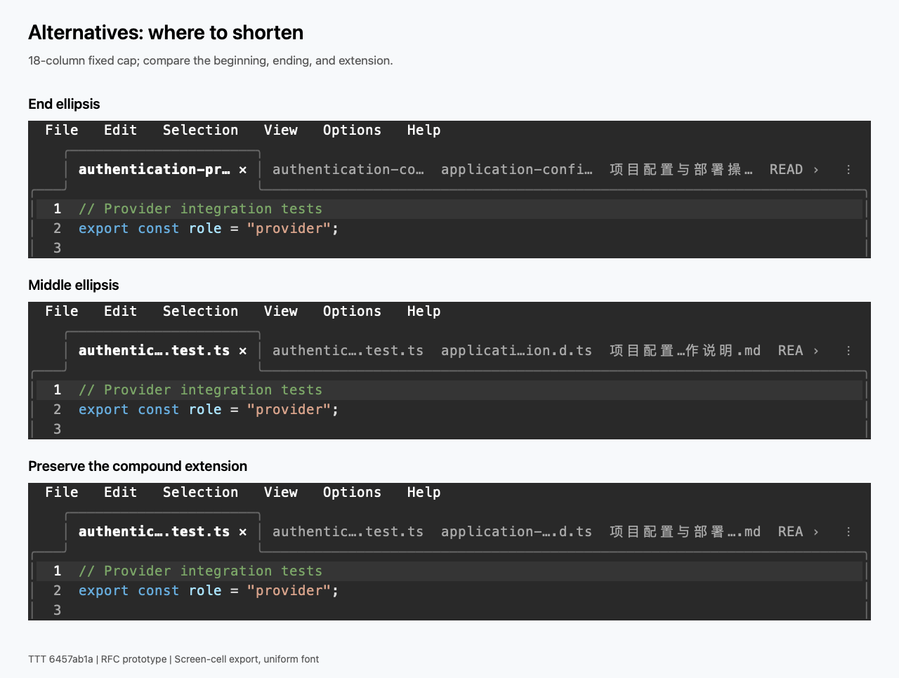
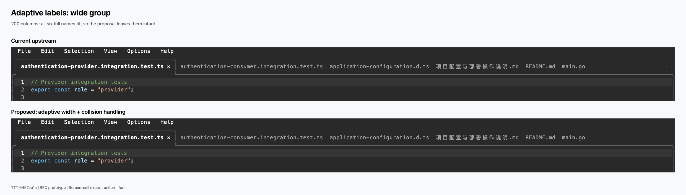
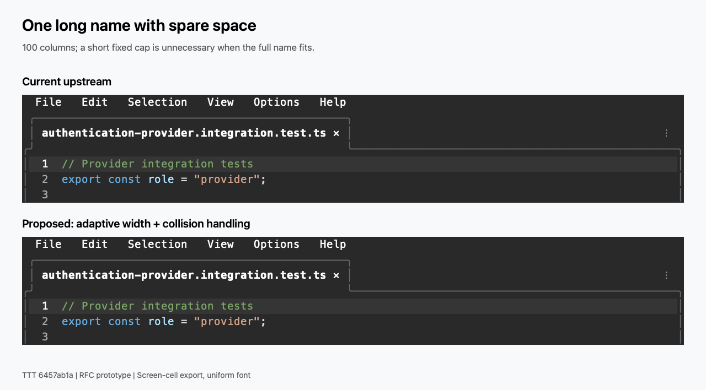
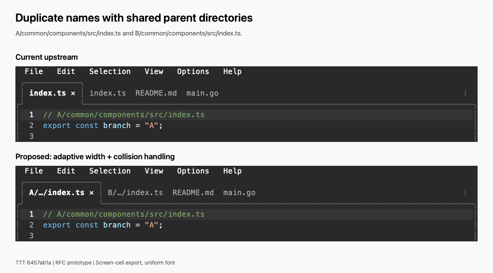

Status: Draft
Issue: #1285
Date: 2026-11-09

# Adaptive editor tab labels

## Summary

Keep full names when they fit. Otherwise shorten long names towards an 18-column compression floor, using middle ellipsis and the existing scrolling. Distinguish collisions with directory context or a filename fragment while preserving the name's beginning. Implementation follows in a separate PR after this RFC is accepted.

## Motivation

Current labels use the basename without a length limit. One long name can occupy most of a narrow editor group, while two `index.ts` tabs can look identical. A short fixed cap increases the number of visible tabs but can also remove the exact text needed to distinguish files.

## Inventory

Baseline: [`6457ab1a`](https://github.com/eugenioenko/ttt/commit/6457ab1aa47638c3dd41f18a7969b8468f3ce512). The inventory is source-inspected; screenshots cover file labels, directory conflicts, and tab decorations.

| Kind | Example / current label | Construction |
| --- | --- | --- |
| Ordinary file | `main.go`, `README.md` | [`EditorGroupWidget.OpenFile`](../internal/ui/editor_group.go) sets the file and icon path; `syncTabs` forwards the name. |
| Dotfile / no extension | `.env.example`, `Dockerfile` | Same file pipeline; [`tabLabelParts`](../internal/ui/tabbar_widget.go) uses `filepath.Base(tab.Name)`. |
| Long / compound extension | `authentication-provider.integration.test.ts`, `application-configuration.d.ts` | Same pipeline; no built-in filename length limit or compound-extension policy. |
| Fullwidth / CJK | `项目配置与部署操作说明.md` | Same pipeline. [`textwidth.String` and `Rune`](../internal/textwidth/textwidth.go) define terminal-cell width, including wide characters. |
| Duplicate basename | `src/index.ts`, `tests/index.ts` both become `index.ts` | `tabLabelParts` discards directory components; no automatic directory qualification. |
| Working-tree Open Changes | Usually the ordinary file name with an editable inline diff; fallback separate diffs use `file.ts (diff)` | [`OpenChangeDiff`](../internal/app/callbacks.go) first tries `openInlineDiff`; `readChangeDiff` builds the fallback name. |
| Staged diff | `file.ts (staged) (diff)` when the staged identifier passes through the common diff suffix | `readChangeDiff` builds `file.ts (staged)`; [`OpenDiffTab` and `syncTabs`](../internal/ui/editor_group.go) retain that identifier and append ` (diff)` for a separate diff widget. |
| Current Changes | `Current Changes`, or `Changes · repository` for multiple repositories | [`currentChangesTitle` and `OpenCurrentChanges`](../internal/app/current_changes.go), then `OpenPluginTab`. |
| Commit Details | `Commit abc1234` | [`OpenCommitDetail`](../internal/app/changes_async.go) opens a custom content tab; contained files are not independent editor tabs. |
| File opened from a commit | `file.ts @ abc1234 (diff)` | [`readCommitDiff`](../internal/app/callbacks.go) supplies a title containing the short revision; `syncTabs` appends the diff marker. |
| PR overview / individual PR file | Overview uses `group.Name`; a file uses `file.ts (diff)` | [`OpenPRDetail`](../internal/app/pr.go) opens a custom tab; `OpenPRDiff` in `callbacks.go` opens an individual diff. |
| Settings | `Settings`; JSON commands open `settings.json` or `keybindings.json` as files | [`settings_view.go`](../internal/app/settings_view.go) uses `OpenPluginTab`; JSON commands are in `commands_palette.go`. |
| Untitled buffers | `untitled`, `untitled-2`, etc. | [`NewFile` and `nextUntitledName`](../internal/ui/editor_group.go); the numeric part distinguishes buffers. |
| Plugin content / read-only buffer | Plugin-provided title; a read-only buffer can also supply a custom title | `OpenPluginTab`, `OpenBufferReadOnly`, and `OpenFileReadOnly` in `editor_group.go`; application callbacks are in `commands_plugin.go`. |
| Plugin file handler | The handled file's basename, e.g. `paper.pdf` | [`openWithFileHandler`](../internal/app/file_handlers.go) returns content, then `openContentFileTab` retains the file name and icon path. |
| Image / binary file | `image.png`, `data.bin` | `OpenFile` selects `ImageViewWidget` or `BinaryFileWidget`, then the same content-file tab pipeline. |
| Editor terminal / configured app | Configured label, shell basename such as `zsh`, or `Terminal` | [`editorTerminalTitle`](../internal/app/terminal_editor.go); [`TerminalTabWidget.TabIcon`](../internal/ui/terminal_tab.go) can supply an explicit icon. |

All labels ultimately pass through `syncTabs`, `tabLabelParts`, and `drawTabLabel`. An explicit `Title` replaces the underlying path before basename handling.

| Decoration | Plain icons | Nerd Font icons | Source / budget implication |
| --- | --- | --- | --- |
| File icon | Usually absent | Icon selected from the icon path | `FileIconForPath`; explicit `Tab.Icon` overrides it. Reserve the actual glyph and spacing width. |
| Read-only | ` (readonly)` | Lock glyph before the name | `tabLabelParts`, [`tabbar.readonly`](../internal/i18n/en.json), and [`tabbar_readonly_test.go`](../internal/ui/tabbar_readonly_test.go). |
| Modified | `●` before the name | Same dirty marker | `tabLabelParts`; warning styling in `drawTabLabel`. |
| Pinned | `♦` on the active, closable pinned tab | Nerd Font pinned glyph | Replaces the active tab's close action. |
| Close | `✕` on the active, closable unpinned tab | Same close-action path | Its hit position must follow the rendered span. |
| Layout | Margins, active-tab borders, overflow arrows, More button | Same layout, actual glyph widths | Reserve before distributing filename space; they are not part of the filename budget. |

## Options

### Fixed filename limits

The same six files at 8, 10, 12, 18, and 24 columns, in a 100-column group. Short caps hide much of the name; even 18 and 24 produce identical provider/consumer labels.

### Cut position

At 18 columns, end ellipsis hides the extension; middle ellipsis can hide distinguishing text; preserving the compound extension leaves less room for the stem.

### Adaptive width with collision handling

Use the group's available space to choose a common cap for name text, including directory qualifiers. Reserve decorations and semantic annotations separately. Keep full names when they fit; reduce the cap towards 18 columns when crowded, then scroll. Collision handling may require wider labels.

### Directory qualification

For `A/common/components/src/index.ts` and `B/common/components/src/index.ts`, display `A/…/index.ts` and `B/…/index.ts`. Start at the immediate parent and search upwards until the paths differ. Collapse shared intermediate directories. If this produces another collision, retain more of the distinguishing directory context.

### Capture method and scope

The isolated prototype runs TTT with `--new-window`, `--size Wx24`, `--exec`, and a separate `TTT_CONFIG_DIR`. Each comparison uses the same ordered files. `exec "View: Next Tab"` selects the first; state examples use `type X; exec "View: Toggle Pin Tab"` without saving.

The PNGs rasterize TTT's actual screen-cell text, positions, and styles with uniform fonts. They are screen-cell exports, not native terminal-window captures. CJK filenames are intentional test data.

All nine baseline scenarios matched the unmodified binary's text output byte-for-byte. The single-file proposal also matches upstream. Selected tab-bar text from `--exec` is in [screen-text.txt](assets/1285/screen-text.txt).

## Recommendation

1. **Adapt to the editor group.** Keep full names when they fit, compress long names towards 18 columns when crowded, and retain scrolling beyond that point. Short names stay complete.
2. **Preserve recognition.** Keep the filename beginning and extension when feasible, including compound extensions such as `.test.ts` and `.d.ts`. Plain icon mode must remain usable.
3. **Resolve duplicates.** Add directory context only when needed, collapsing common intermediate directories as `A/…/index.ts`.
4. **Resolve shortening collisions.** Preserve the beginning, a distinguishing fragment, and the extension: `auth…prov….test.ts` versus `auth…cons….test.ts` at 18 columns. Widen labels and allow scrolling if the fragment is insufficient.
5. **Preserve identifiers.** Diff/staged markers, commit references, and untitled counters must remain distinguishable. Define how custom titles separate names from these annotations before implementation.
6. **Share layout geometry.** Measure with `textwidth`; drawing and action hit testing must reuse the final labels and spans without changing tab identities or paths.

The prototype checks adaptive width, CJK measurement, name collisions, semantic suffixes, and close/unpin positions. Implementation regression tests belong in the follow-up PR.

References: VS Code's [tab sizing](https://code.visualstudio.com/updates/v1_19#_new-editor-tabs-layout-option) and [duplicate labels](https://github.com/microsoft/vscode/blob/main/src/vs/workbench/browser/parts/editor/multiEditorTabsControl.ts), Zed's [disambiguation](https://github.com/zed-industries/zed/blob/main/crates/util/src/disambiguate.rs), and [mini.tabline](https://github.com/nvim-mini/mini.tabline#features).

## Open questions

- Is 18 columns the right compression floor, and should it be configurable?
- Is a second ellipsis acceptable for collision cases, or is widening preferable even when fewer tabs remain visible?
- How should labels remain stable during resize and tab open/close transitions? The prototype recalculates from the current group.
- How should an editor group narrower than one readable label plus its actions degrade? A guaranteed hard floor cannot apply below the group's own available width.
- How should custom titles, terminal/app labels, multi-repository paths, and translated read-only text affect the budget?
- Track full name/path on hover in a separate issue after implementation, as requested in #1285.
